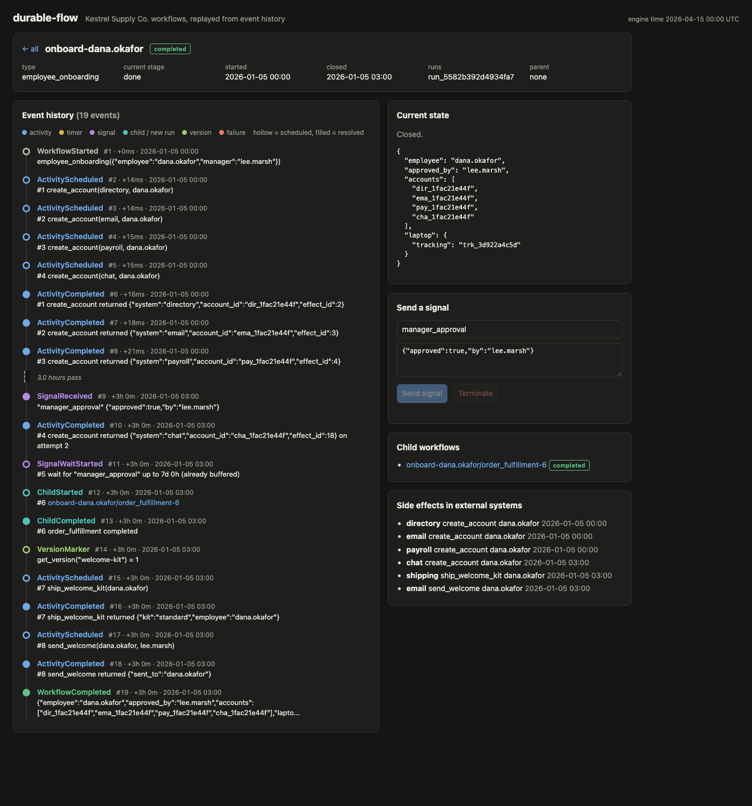
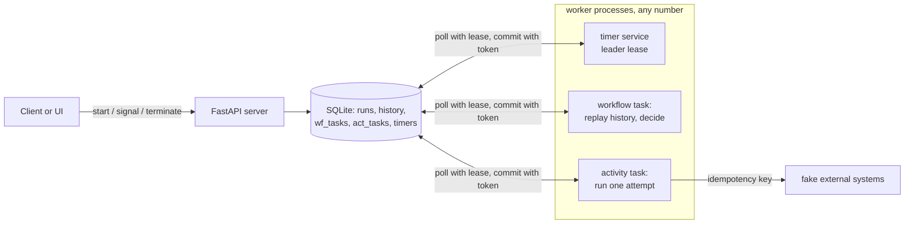

# durable-flow

A small durable workflow engine in the style of Temporal and AWS Step Functions. Workflows are plain Python generator (or async) functions that yield commands: run an activity, sleep for 30 days, wait up to 7 days for a signal, start a child workflow, run activities in parallel. Every step is written to an append-only event history in SQLite. When a worker crashes, a deploy restarts everything, or a dependency fails for an hour, another worker replays the history, gets every finished step's recorded result without running it again, and carries on from where the workflow stopped. A chaos command runs 200 workflows across 4 worker processes while it kills workers with SIGKILL and fails 20% of activity calls, then checks six invariants.



```
chaos: 200 workflows, 4 workers, seed 7
  real time 11.0s, virtual time 120.0 days, 32 time skips
  workers SIGKILLed 7, self-crashed after a side effect 22
  activity attempts 1360, retries 307, lease takeovers 23 activity / 1 workflow, fenced late reports 0
  workflow tasks 1475, commands replayed from history 4209, signals sent 56

invariants:
  [PASS] every workflow completed or compensated: 247 workflows (incl. children): compensated 55, completed 192
  [PASS] each activity scheduled once and resolved once: 1053 activities, 0 with a bad event count
  [PASS] side effects applied at most once per successful attempt: 998 effects, 1360 attempts, 23 repeat calls absorbed by idempotency keys, 0 duplicates, 0 unreported effects undone by compensation, 0 unaccounted effects
  [PASS] compensations ran for every step, in reverse order: 38 compensated workflows with side effects checked
  [PASS] timers fired once, never early, in fire-time order: 175 fired (166 sleeps, 9 signal timeouts), 56 canceled, 0 early, 0 out of order, 0 lost
  [PASS] histories contiguous and capped by continue-as-new: longest history 22 events (cap 60), 44 continue-as-new hand-offs, 0 runs with gaps

ALL INVARIANTS HOLD
```

| Result | Number |
|---|---|
| Tests | 94 passing (replay, non-determinism, versioning, retries, timeouts, timers, signals, children, parallel, sagas, continue-as-new, leases, API, chaos) |
| Chaos run (200 workflows, 4 workers, seed 7) | 6 of 6 invariants hold, about 11 seconds on a laptop, 120 virtual days |
| Extra chaos seeds (200 workflows, kills every 0.7s, 5% crash after side effect) | 6 of 6 seeds pass all invariants (24 to 31 kills and 50 to 70 post-effect crashes per run) |
| Engine and UI | about 3,300 lines of Python, HTML, and JS, no dependencies beyond FastAPI and uvicorn |

## Why

Business processes outlive the processes that run them. An employee onboarding waits a week for a manager. A subscription renews every 30 days for years. An order saga charges a card and then finds the address is invalid. Written as plain code with a queue and a cron job, each of these turns into a state machine spread across tables, retry loops, and timers that nobody can read in one place, and the failure cases (crash after charging, before recording; two workers picking up the same job; a timer lost in a deploy) are where money and trust leak.

The durable execution model fixes this by letting the process be ordinary code and making the engine responsible for durability. This project builds that model from the parts that matter and shows each failure being handled:

| Failure | How it is handled | Where |
|---|---|---|
| Worker dies mid-workflow | Workflow state is rebuilt by replaying history; finished steps return recorded results | `workflow.py` (Replayer) |
| Worker dies mid-activity | Activity task lease expires, another worker takes it as the next attempt | `engine.py` `poll_activity_task` |
| Crash after the side effect, before the result is recorded | Each activity gets an idempotency key (`run_id:command`); the external system returns the first result for a repeated key | `worker.py` `ActivityContext.effect`, `engine.py` `apply_side_effect` |
| Old worker wakes up and reports late | Every report carries the lease token; a stale token is rejected (fencing) | `engine.py` `complete_activity`, `complete_workflow_task` |
| Flaky dependency | Retry policy per activity: max attempts, exponential backoff, cap, non-retryable error types | `workflow.py` `RetryPolicy` |
| Hung activity | Start-to-close and heartbeat timeouts | `worker.py` `_timed_out`, `engine.py` `heartbeat` |
| Timer lost in a deploy | Timers are rows; one leader (leased row) fires due timers in fire-time order | `engine.py` `fire_due_timers` |
| Code change breaks running workflows | Replay checks each command against history and fails with a clear `NonDeterminismError`; `get_version` branches safely; `durableflow replay` checks stored histories before a deploy | `workflow.py`, `cli.py` |
| Step fails for good halfway through a saga | Compensations run newest first; each one is registered before its step, and is a no-op when there is nothing to undo | `examples.py` |
| History grows forever | `continue_as_new` closes the run and starts a fresh one with only the carried state | `engine.py`, `examples.py` |

## Programming model

```python
from durableflow import DAY, Compensated, RetryPolicy, activity, child_workflow, parallel, wait_signal
from durableflow.errors import ParallelError, SignalTimeout

@examples.workflow()
def employee_onboarding(ctx, inp):
    emp = inp["employee"]
    try:
        accounts = yield parallel(*[activity("create_account", s, emp) for s in SYSTEMS])
    except ParallelError:
        yield from undo_accounts(emp)
        return Compensated("account creation failed")
    try:
        approval = yield wait_signal("manager_approval", timeout=7 * DAY)
    except SignalTimeout:
        yield from undo_accounts(emp)
        return Compensated("manager approval timed out after 7 days")
    laptop = yield child_workflow("order_fulfillment", {...})
    if ctx.get_version("welcome-kit", 0, 1) >= 1:  # added after runs were already in flight
        yield activity("ship_welcome_kit", emp)
    yield activity("send_welcome", emp, inp["manager"], retry=RetryPolicy(max_attempts=25))
    return {"employee": emp, "laptop": laptop}
```

Activities are ordinary functions that take an `ActivityContext` first. They can call `ctx.heartbeat(details)` and read `ctx.attempt` and `ctx.idempotency_key`.

The three examples for the made-up retailer Kestrel Supply Co. live in `src/durableflow/examples.py`:

1. **employee_onboarding**: accounts in directory, email, payroll, and chat in parallel; up to 7 days for a `manager_approval` signal; a laptop ordered through a child `order_fulfillment` workflow; a welcome email. If a later step fails for good, the accounts are deleted in reverse order.
2. **order_fulfillment**: a saga. Reserve inventory, charge payment, ship. Card declined, out of stock, and invalid address are non-retryable business errors that trigger compensation (refund, then release).
3. **subscription_renewal**: sleeps 30 days, charges, repeats. Every few renewals it continues as new, so a 10 year subscription never has more than about 30 events in one history.

## Architecture



One workflow task, start to finish:

```
lease wf_task (token, expires in 20s)
  -> load history -> replay the workflow function
       command #1 in history?  check kind and name match, return the recorded result
       command #k not in history?  collect it as new and stop
  -> one transaction: token still ours? append ActivityScheduled / TimerStarted / ...,
     insert act_tasks and timers, update stage, delete or reschedule the wf_task
```

History events: `WorkflowStarted`, `ActivityScheduled`, `ActivityCompleted`, `ActivityFailed`, `TimerStarted`, `TimerFired`, `SignalWaitStarted`, `SignalReceived`, `SignalWaitTimedOut`, `ChildStarted`, `ChildCompleted`, `ChildFailed`, `VersionMarker`, `WorkflowCompleted`, `WorkflowCompensated`, `WorkflowFailed`, `WorkflowTaskFailed`, `WorkflowContinuedAsNew`, `WorkflowTerminated`.

Determinism rules the replayer enforces:

- Commands are numbered in the order the code issues them. A command whose number is already in history must have the same kind and name (timer durations may change).
- Code that finishes with fewer commands than history has is also a mismatch.
- A signal wait resolves to the earliest unconsumed matching signal that comes before its timeout event in history. History order is fixed, so every replay picks the same signal.
- `get_version(change_id, min, max)` records `max` for new executions, returns 0 for histories that already passed that point, and fails the task when the recorded version is out of range. User code cannot swallow that error.
- `ctx.now()` is the timestamp of the last event the code has observed, not the wall clock.

Time: every component reads one `Clock`. Tests use a `VirtualClock`. The chaos run uses a `DbClock`: a row in SQLite that all processes read, running at 20 virtual seconds per real second and jumping straight to the next timer when nothing is runnable (Temporal's test server calls this time skipping). That is how 120 days of renewals and 7 day approval timeouts finish in about 11 seconds.

## How to run

```bash
cd durable-flow
uv sync --python 3.12

# Seed a database with 14 example workflows in every state, then open the UI
uv run durableflow demo --db data/demo.db
uv run durableflow server --db data/demo.db --workers 1 --port 8823
# http://127.0.0.1:8823 : open onboard-ren.adeyemi and press "Send signal"

# Separate worker processes instead of the embedded one (run as many as you like)
uv run durableflow worker --db data/demo.db --id w1
uv run durableflow worker --db data/demo.db --id w2

# Chaos: 200 workflows, 4 workers, SIGKILL every 1.5s, 20% activity failures,
# 2% of attempts crash the worker right after their side effect
uv run durableflow chaos --workflows 200 --workers 4 --seed 7

# Replay every stored history against the current code (run this before a deploy)
uv run durableflow replay --db data/demo.db
```

API (JSON):

| Method | Path | What it does |
|---|---|---|
| POST | `/api/workflows` | start `{workflow_type, input, workflow_id?}`; starting a running id returns it (safe to retry) |
| GET | `/api/workflows?status=&type=&q=&limit=&offset=` | list, latest run per workflow id |
| GET | `/api/workflows/{id}` | status, stage, pending commands, runs, children, side effects |
| GET | `/api/workflows/{id}/history?run_id=` | the event history |
| POST | `/api/workflows/{id}/signal` | `{name, payload}` |
| POST | `/api/workflows/{id}/terminate` | `{reason}` |
| GET | `/healthz`, `/metrics` | health, Prometheus metrics |

Metrics include `durableflow_task_queue_depth{queue,state}`, `durableflow_workflows{status}`, `durableflow_task_schedule_to_start_seconds` (histogram per queue), and counters for retries, lease takeovers, fenced reports, replayed commands, timers fired, and non-determinism errors. Logs are one JSON object per line.

Docker (not installed on the machine this was built on, so the image and compose file are built and smoke tested in CI):

```bash
docker compose up --build -d     # server on :8000 plus 3 workers on one volume
docker compose kill worker-2     # its leased tasks move to the other workers
```

## Tests

94 tests, about 7 seconds: `uv run --python 3.12 --group dev pytest -q`

| File | Tests | What it checks |
|---|---|---|
| `test_replay.py` | 9 | recorded results come back without running activities (a replay with activities that raise still completes), partial replay stops at the frontier, async workflows, `ctx.now()` and `is_replaying` |
| `test_nondeterminism.py` | 6 | renamed activity, changed command kind, code that stops early, timer duration change allowed, unsupported version cannot be caught by user code, `replay` CLI exit code |
| `test_versioning.py` | 5 | new runs record the max version, old histories keep the old branch, runs blocked before the change take the new branch |
| `test_retries.py` | 9 (11 cases) | attempts until success, backoff gaps of 2s, 6s, 18s, cap, max attempts, non-retryable by type and by flag |
| `test_timeouts.py` | 8 | start-to-close, heartbeat timeout, heartbeats keep a long activity alive, lease expiry and takeover, fencing of the late report |
| `test_timers.py` | 7 | fires at its time and not before, survives a new engine and worker, fire-time order, timer leader election and failover |
| `test_signals.py` | 8 | payload delivery, timeout, signal after timeout, buffered signal, in-order consumption, closed and unknown workflows |
| `test_children_parallel.py` | 9 (10 cases) | child results and failures, parallel results in order, branches scheduled together, partial failure detail |
| `test_examples.py` | 11 | each saga path, compensation order, onboarding approved, rejected, timed out, partial failure, laptop failure, continue-as-new chain |
| `test_engine.py` | 7 | workflow task lease takeover and fencing, events during a task reschedule it, terminate, list filters, shared DB clock |
| `test_api.py` | 6 | start, signal, describe, history, terminate and 409, 404 and 400, list filters, metrics |
| `test_chaos.py` | 6 | a 24-workflow multi-process chaos run, seeded plans and faults, and that the checker fails on a planted duplicate effect and an out-of-order timer |

CI runs ruff, the tests, a 60-workflow chaos run as an invariant gate, `durableflow replay` over the demo data, then builds the Docker image and runs a workflow through a server container and a worker container.

## Concepts mapped to Temporal and Step Functions

| durable-flow | Temporal | AWS Step Functions |
|---|---|---|
| workflow function (generator or async) | workflow definition | state machine (ASL JSON) |
| `activity(...)` | activity | Task state |
| `RetryPolicy` | retry policy | `Retry` block (`MaxAttempts`, `BackoffRate`, `IntervalSeconds`) |
| non-retryable error types, `Compensated` | `ApplicationError(non_retryable)`, saga pattern | `Catch` to a compensation branch |
| `start_to_close`, `heartbeat_timeout` | same names | `TimeoutSeconds`, `HeartbeatSeconds` |
| `sleep(30 * DAY)` | `workflow.sleep` / durable timer | Wait state |
| `wait_signal(name, timeout)` | signal plus `workflow.wait_condition` with timeout | `.waitForTaskToken` with a timeout |
| `child_workflow` | child workflow | nested `StartExecution` |
| `parallel(...)` | `asyncio.gather` over activities | Parallel state |
| `continue_as_new` | continue-as-new | start a new execution from the last state |
| `get_version` | `workflow.patched` / `GetVersion` | new state machine version and alias |
| event history in `history` | event history | execution history |
| `wf_tasks`, `act_tasks` with leases | task queues, sticky and normal | managed by the service |
| `durableflow replay` | replayer in CI | not needed (state machine, not code) |
| idempotency key `run_id:command` | activity id plus workflow id | `$$.Execution.Id` plus state name |

## Production notes

- **History store.** SQLite with one writer at a time is the limit here (about 1,475 workflow tasks and 1,360 activity attempts in 11 seconds with 4 processes). At scale the history goes to Cassandra or Postgres partitioned by workflow id, as Temporal does, with each shard owned by one history service host through a lease, the same idea as the timer leader here.
- **Sharding.** Workflow ids hash to a fixed number of shards. Each shard has its own task queues and timer queue, and shard ownership moves between hosts through a membership ring. Transfer tasks move work between shards (a child on another shard, a signal from outside).
- **Visibility store.** The list and filter queries here scan the runs table. In production they go to a separate, eventually consistent index (Elasticsearch or OpenSearch) fed from history events, so listing never touches the history database.
- **Sticky execution.** Every workflow task here replays the full history. Real workers cache the workflow state in memory and only replay on a cache miss, which turns most tasks into a few new events.
- **Payloads and retention.** Large inputs and results belong in object storage with a pointer in history, and closed histories are archived after a retention period.
- **Deploys.** Run `durableflow replay` against a sample of production histories in CI before shipping workflow code, and use `get_version` for every change to command order.

## License

MIT. See [LICENSE](LICENSE).
